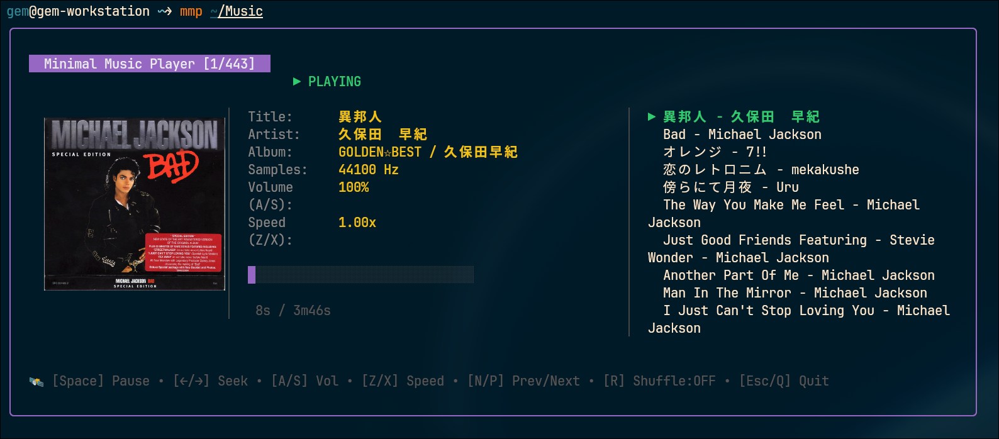
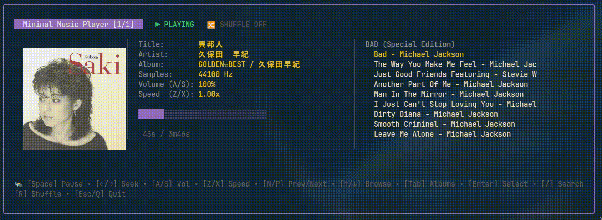

# mmp


A terminal FLAC music player in Go. Built with [beep](https://github.com/gopxl/beep) (audio) and [Bubble Tea](https://github.com/charmbracelet/bubbletea) (UI).


### Search
press `/` then follow by keyword

## Install

Needs Go, plus ALSA on Linux (`sudo apt install libasound2-dev`) or CoreAudio on macOS (built in).

```bash
go build -o mmp
```

## Usage

```bash
./mmp song.flac      # play a file
./mmp ~/Music        # play a directory (recurses for .flac)
```

Tracks are grouped into albums by the `ALBUM` tag (parent directory name if untagged) and ordered by `TRACKNUMBER`.

## Keys

| Key | Action |
|-----|--------|
| `Space` | Play / pause (progress bar turns yellow while paused) |
| `←` / `→` | Seek -5s / +5s |
| `n` / `p` | Next / previous track (crosses albums) |
| `↑` / `↓` | Move cursor in the list |
| `Tab` | Switch list between albums and tracks |
| `Enter` | Open album / play selected track |
| `/` | Search tracks (title, artist, album); `Enter` plays, `Esc` cancels |
| `r` | Toggle shuffle (random track within the album) |
| `a` / `s` | Volume down / up |
| `z` / `x` | Speed down / up |
| `q` / `Esc` / `Ctrl+C` | Quit |

## Album art

Covers are read from the FLAC's embedded picture.

- **kitty / ghostty:** drawn at full resolution via the kitty graphics protocol. Disabled inside tmux/screen and over SSH.
- **Other terminals:** drawn as 24-bit ANSI half-blocks (`▀`), so a true-color terminal is needed.
- **No embedded cover:** shows a `♪ no cover` placeholder.

## Tips

Convert m4a to flac:
```bash
ffmpeg -i song.m4a -c:a flac song.flac
```

Show a file's tags:
```bash
ffprobe -v error -show_entries format_tags:stream_tags -of default=noprint_wrappers=1 song.flac
```
